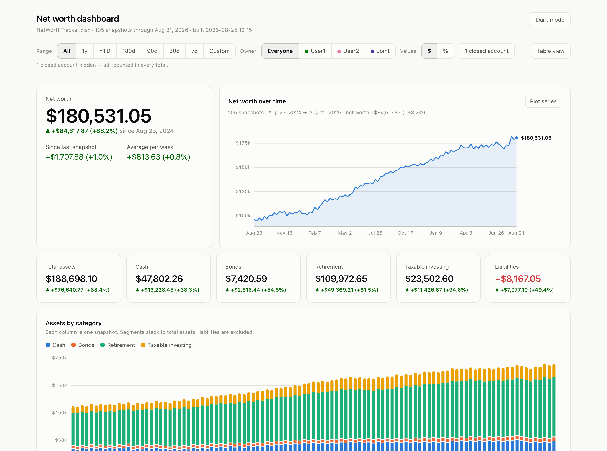

# Net worth dashboard

Turn a spreadsheet of account balances into a single self-contained HTML
dashboard. No server, no build step, no dependencies, no data leaving your
machine — the whole thing is one `.html` file you open by double-clicking.

You keep tracking balances in Excel (or Numbers, or LibreOffice) the way you
already do. This reads the workbook and renders it.



## Quick start

```bash
git clone https://github.com/sjojoa/networth-dashboard.git
cd networth-dashboard
python3 build_dashboard.py
open NetWorth_Dashboard.html      # or just double-click it
```

On macOS you can skip the command line from here on — see
[One-click refresh](#one-click-refresh-on-macos).

The repo ships with `NetWorthTracker.xlsx` — two years of **invented** weekly
data for three fictional people — so you can see the whole thing working before
pointing it at your own numbers. Regenerate it any time:

```bash
python3 make_demo_workbook.py                       # the shipped sample
python3 make_demo_workbook.py --scale 4             # a larger portfolio
python3 make_demo_workbook.py --weeks 260 --seed 3  # five years, different draw
```

| Flag | Effect |
|---|---|
| `--weeks N` | How many weekly snapshots (default 105, about two years) |
| `--seed N` | Change the random draw (default 7, so results are reproducible) |
| `--scale N` | Multiply every balance — the sample is deliberately modest |
| `--max-total N` | Fail if net worth would ever exceed N (off unless you pass it) |

These only shape the fabricated sample. **Nothing in the dashboard caps the
values it will display** — point it at a workbook of any size and it renders what
it finds.

**Requirements:** Python 3.6+. That's it — standard library only, so the
`python3` already on your machine will do, including the one Apple ships.

### One-click refresh on macOS

Skip the Terminal entirely after a one-time setup step.

**Once, to set it up:**

```bash
./launcher/build_launcher.sh
```

That compiles `Net Worth Dashboard.app` into this folder. You never need to run
it again.

**Every time after that: just double-click `Net Worth Dashboard.app`.** It checks
whether the spreadsheet changed since the last build, rebuilds only if it did,
and opens the dashboard in your browser. No commands, no Terminal.

So the day-to-day loop is: update balances in Excel → save → double-click the app.

Two notes:

- The first double-click may ask for permission to read the folder your
  spreadsheet is in (more likely if it's in iCloud, Dropbox or similar). Allow it
  once and it won't ask again.
- Keep the app next to the scripts. It finds its own folder at launch, so you can
  move or rename the directory without rebuilding.

On Windows and Linux there's no equivalent one-click wrapper — run
`python3 build_dashboard.py --if-needed` and open the HTML, or wire that pair into
a shortcut or shell alias.

## What you get

**A filter bar that scopes the whole page**

- **Range** — All · 1y · YTD · 180d · 90d · 30d · 7d · Custom. Snapshots are
  usually weekly, so a custom date that isn't a snapshot snaps *back* to the
  nearest one on or before it, and says so.
- **Owner** — everyone, or one person. Read from the spreadsheet's legend.
- **Values: $ / %** — one switch for every figure on the page (see below).
- **Closed accounts** — show or hide accounts you no longer hold.
- **Table view** — every number in the workbook, for the current filters.

**A net worth chart you can put anything on**

Plot up to four series alongside — or instead of — net worth: individual
accounts, a total per person, or a total per category. Switch the net worth line
off and the smaller lines get the full axis. Hover for values at any snapshot, or
focus the chart and walk it with ← →.

**Then:** stat tiles per category · assets stacked by category over time ·
balances owed ·each account's contribution to net worth over the range · and a card
per account with its balance, change, share and sparkline.

Light and dark themes, with the choice remembered.

**A Projection tab**

Starts from your latest balances and compounds three groups forward —
**Investments** (`Taxable investing`), **Retirement** and **Bonds** — each with
its own monthly contribution and average annual return (defaults 7% / 7% / 4%).
Cash, property, custom categories and debt are held at today's balance.

- Pick how many years to project, and switch between nominal dollars and
  **today's dollars** (deflated by the inflation rate you set).
- Tiles break the result into today's balance + contributions + growth, which
  always add up to the projected total.
- Hover the chart for any year; the table below lists every year.
- The Owner filter applies, and contributions are saved separately per owner
  view. Inputs are remembered in the browser, so rebuilding the dashboard keeps them.

Compounding is monthly, with contributions landing at month end. It's a
straight-line average-return model — real returns vary year to year, so treat
the output as a rough guide rather than a forecast.

### The $ / % switch

Percent means something specific to each chart, so each one says which in its
subtitle:

| Where | What `%` shows |
|---|---|
| Headline and stat tiles | Change over the range, percentage first |
| Net worth chart | Each line's change since the range started — so a $2k account and a $150k one are comparable on one axis |
| Assets by category | Each category's **share of total assets** (columns become 100% tall) |
| Balances owed | Each account's **share of everything owed** |
| Change by account | Each account's **own** percent change |

Anything starting at $0 in the range has no percentage; it drops out of that view
and the note names it. Account cards always show both, `▲ +$2,558.02 (+25.1%)`.

Amounts carry cents everywhere except axis labels, which stay rounded (`$150k`) —
those are a scale to read positions against, not a figure to reconcile.

## Your own data

Point it at any workbook:

```bash
python3 build_dashboard.py ~/Documents/MyTracker.xlsx
```

Or name yours `NetWorthTracker.xlsx` and drop it in this folder.

### Spreadsheet layout

| Row | Holds |
|---|---|
| 1 | **Legend** — one coloured cell per owner. The text is the name. |
| 2 | *(free)* |
| 3 | **Category** per account — optional, see below |
| 4 | **Headers** — `Date`, one column per account, then `Total` |
| 5+ | One row per snapshot: the date, then each balance |

Rules worth knowing:

- **Ownership comes from the header cell's fill colour**, matched against the
  legend in row 1. Colour a header like `User1`'s legend cell and that account is
  User1's. A legend entry with no accounts yet still shows in the Owner filter,
  greyed out, holding its colour.
- **The `Total` column is ignored.** Totals are recomputed from the accounts, so
  the dashboard can't drift from the underlying numbers. Anything to the right of
  `Total` is ignored too, so notes there are safe.
- **Liabilities are negative numbers.** They show in red, count against net
  worth, and appear in the "balances owed" chart as positive amounts so a shorter
  bar plainly means less debt.
- Snapshots don't have to be weekly or evenly spaced. Blank rows are skipped.

### Categorising an account

Four things are tried, in order:

1. **Row 3** — type the category above the account name. Anything you type
   works: `Cash`, `Bonds`, `Retirement`, `Taxable investing`, `Property`,
   `Liabilities` (or `Debt`), or something of your own like `Crypto`, which
   becomes a new category with its own colour, tile, chart segment and section.
2. **`CATEGORY_OVERRIDES`** in `build_dashboard.py`, for names no keyword catches.
3. **The account name.** `401k` `403b` `IRA` `Roth` `pension` → Retirement ·
   `brokerage` `taxable` `ETF` `crypto` → Taxable investing · `checking`
   `savings` `cash` `HYSA` → Cash · `bond` `treasury` → Bonds · `home` `car` →
   Property · `card` `loan` `mortgage` `debt` → Liabilities.
   Matching is whole-word, so `September bonus` doesn't become retirement.
4. **The sign.** A column that is never positive is treated as money owed.

Anything unmatched lands in "Other assets" and still appears everywhere.

### Retiring an account

Leave the column in place and let it go to `0`. After three consecutive `$0`
snapshots following a real balance, it's marked closed: it disappears from the
cards, table columns, change chart and series picker, but **keeps counting toward
every total for the period it existed**, so history never changes. The filter bar
grows a button to show them again, tagged with the date last held.

## How it works

```
NetWorthTracker.xlsx ─→ build_dashboard.py ─→ NetWorth_Dashboard.html
                              ↑                    (data baked in)
                        template.html
```

| File | Role |
|---|---|
| `build_dashboard.py` | Reads the workbook, classifies accounts, injects JSON into the template |
| `xlsx_reader.py` | Minimal `.xlsx` parser — an xlsx is a zip of XML, and this reads the few parts needed |
| `template.html` | All the layout, CSS and chart code. Edit this to change how it looks |
| `make_demo_workbook.py` | Generates the fabricated sample workbook |
| `NetWorth_Dashboard.html` | Generated output — don't edit by hand |
| `launcher/` | AppleScript source for the macOS one-click launcher, and its build script |

There's no dependency on `openpyxl` or any other package, which is what lets the
macOS launcher work with the system Python.

### A note on the chart colours

The palettes in `template.html` were checked against colourblind-separation and
contrast thresholds in both light and dark mode, and the **order** of the colour
slots is part of what keeps adjacent series distinguishable. If you change them,
change them as a set and re-check. The four-series cap on the chart is there for
the same reason: past that, hue stops being a reliable way to tell lines apart.

## Privacy

Everything runs locally. The generated HTML has no scripts from anywhere else, no
network calls, and no analytics — open it with the wifi off and it works
identically. Your balances only ever exist in your workbook and in the HTML file
next to it. Don't commit either one to a public repo.

## Licence

MIT — see [LICENSE](LICENSE).
